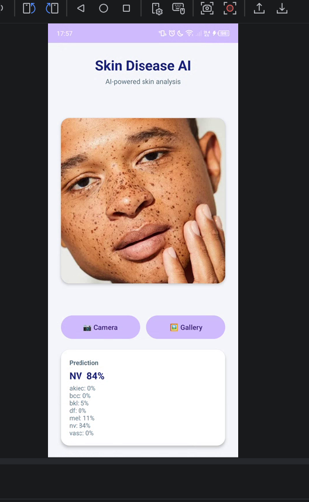
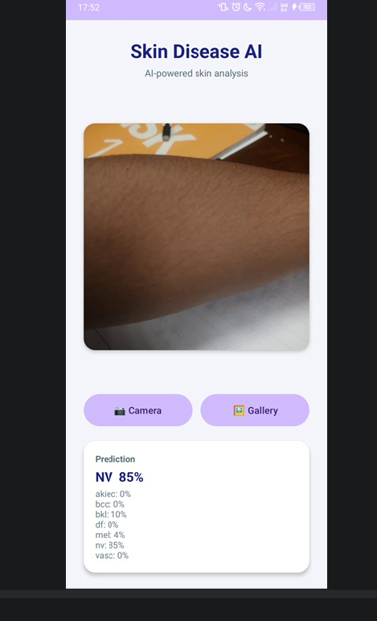
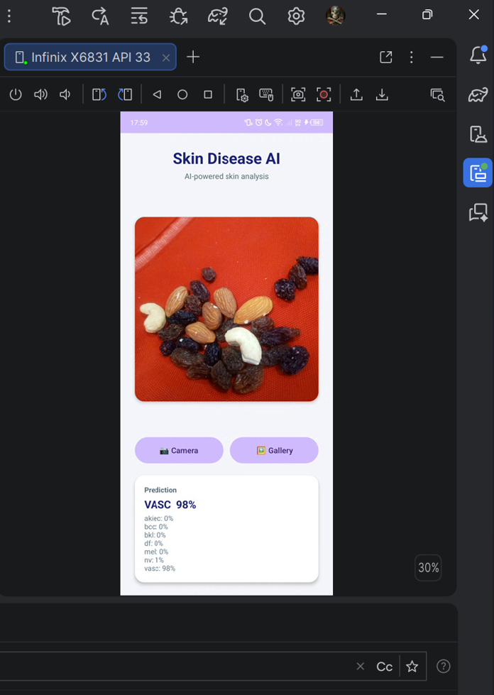
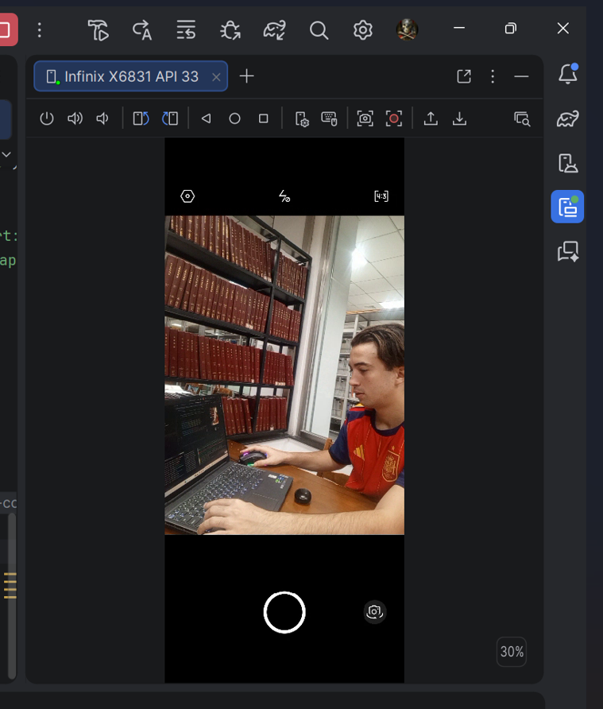
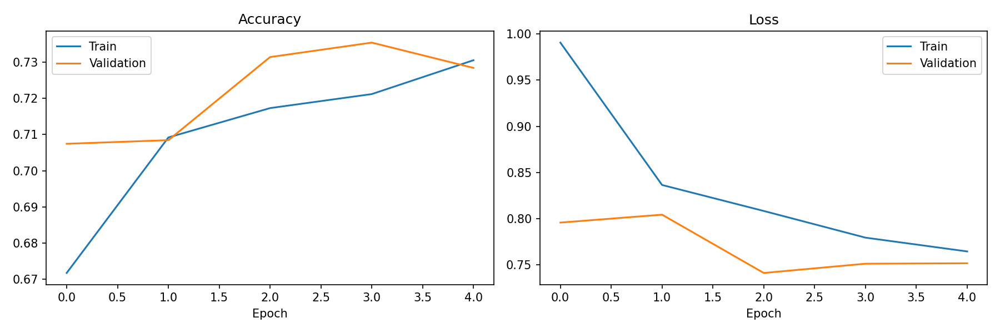

# 🩺 Skin Disease AI — Android App with TensorFlow Lite


> **AI-powered Android app that detects 7 skin diseases from photos using a MobileNetV2 CNN trained on 10,015 dermatoscopic images.**

---

## 📖 Overview

**Skin Disease AI** is an Android application that uses deep learning to assist in early detection of skin diseases. Users take a photo of a skin lesion (or select from gallery), and the app predicts the most likely condition from **7 dermatological classes** — **all processed on-device** using TensorFlow Lite.

**No internet required. No data leaves your phone.**

---

## 🎯 Features

- 📸 **Camera + Gallery** support (CameraX API)
- 🧠 **On-device AI inference** (TensorFlow Lite)
- 🎨 **Clean Material Design UI**
- ⚡ **Instant predictions** (milliseconds)
- 📊 **7-class probability output**
- 🔒 **Privacy-friendly** — 100% offline
- 📱 **Supports Android 7.0+** (99.2% of devices)

---

## 🧬 The 7 Skin Conditions Detected

| Code | Full Name | Type |
|---|---|---|
| **akiec** | Actinic keratoses | Pre-cancerous |
| **bcc** | Basal cell carcinoma | Cancerous |
| **bkl** | Benign keratosis | Benign |
| **df** | Dermatofibroma | Benign |
| **mel** | Melanoma | ⚠️ **Highly dangerous** |
| **nv** | Melanocytic nevi | Common mole |
| **vasc** | Vascular lesions | Blood vessel |

---

## 📸 Screenshots

| Home Screen | Face Analysis | Arm Analysis |
|---|---|---|
|  |  |  |

| Nuts (OOD Test) | Developer |
|---|---|
|  |  |

> **Note:** The "nuts" photo is an **out-of-distribution test** — the model gave a 98% confident prediction even on non-skin input, showing AI's known limitation on OOD data. This is a real ML research topic!

---

## 🧠 How It Works

### 1. Training (Google Colab)
- **Dataset:** HAM10000 (10,015 dermatoscopic images)
- **Model:** MobileNetV2 with transfer learning (ImageNet pre-trained)
- **Training:** 5 epochs, data augmentation (rotation, flip, zoom)
- **Validation Accuracy:** **74.19%**
- **Output:** `.tflite` file (2.55 MB)

### 2. Deployment (Android)
```
User Photo → Preprocess (128×128) → TFLite Inference → Softmax → Display Top Class
```

### 3. Inference Pipeline
- Image resized to **128×128 pixels**
- Normalized to **[0, 1]** range
- Passed through MobileNetV2 CNN
- Returns probabilities for all 7 classes
- Top prediction displayed with confidence

---

## 📊 Model Performance

### Training Progress (5 epochs)

| Epoch | Train Acc | Val Acc |
|---|---|---|
| 1 | 67.56% | 71.39% |
| 2 | 70.93% | 71.69% |
| 3 | 71.89% | 71.26% |
| 4 | 72.32% | 70.69% |
| 5 | **73.71%** | **74.19%** |



### ⚠️ Known Limitations
- **Class imbalance** in dataset (nv has 6,705 vs df has 115)
- **Overconfidence on out-of-distribution inputs** (e.g., predicting "VASC" for nuts photo)
- **74% accuracy** — good for Bachelor's project but not medical-grade

---

## 🚀 Installation

### Prerequisites
- Android Studio (latest)
- Android device or emulator (API 24+)
- Java 11+

### Build Steps
```bash
# 1. Clone the repository
git clone https://github.com/polate77/skin-disease-ai-android.git
cd skin-disease-ai-android/SkinDiseaseAI

# 2. Open in Android Studio
# File → Open → Select the SkinDiseaseAI folder

# 3. Sync Gradle (automatic on first open)

# 4. Build + Run
# Click the green ▶️ Run button
```

### Model Files Already Included
- `app/src/main/assets/skin_model.tflite` (2.55 MB)
- `app/src/main/assets/labels.txt` (7 disease names)

No need to retrain!

---

## 🧪 Retrain the Model (Optional)

Want to retrain on your own data? Open `Skin_Disease_AI_Training.ipynb` in Google Colab:

1. Go to [colab.research.google.com](https://colab.research.google.com/)
2. Upload `Skin_Disease_AI_Training.ipynb`
3. Enable GPU: **Runtime → Change runtime type → T4 GPU**
4. Add Kaggle API key (see notebook)
5. Run all cells
6. Download new `skin_model.tflite`
7. Replace in Android project

**Runtime:** ~15 minutes on free Colab GPU

---

## 📁 Project Structure

```
SkinDiseaseAI-Project/
├── SkinDiseaseAI/                    # Android Studio project
│   ├── app/
│   │   ├── src/main/
│   │   │   ├── java/com/mohammed/skindiseaseai/
│   │   │   │   └── MainActivity.java       # Main app logic
│   │   │   ├── res/
│   │   │   │   ├── layout/activity_main.xml  # UI design
│   │   │   │   └── values/                    # Colors, strings
│   │   │   └── assets/
│   │   │       ├── skin_model.tflite       # AI model
│   │   │       └── labels.txt              # Disease names
│   │   └── build.gradle.kts                # Dependencies
│   └── ...
├── Skin_Disease_AI_Training.ipynb    # Colab training notebook
├── skin_model.tflite                 # Standalone model
├── labels.txt                        # Disease class names
├── history.json                      # Training history
├── training_chart.png                # Accuracy chart
├── screenshots/                      # Demo screenshots
└── README.md
```

---

## 🎯 Use Cases

- 🩺 **Educational tool** for dermatology students
- 📱 **Quick reference** for skin lesion classification
- 🧠 **ML research** base for medical AI projects
- 🎓 **Portfolio project** demonstrating AI + mobile development

---

## ⚠️ Medical Disclaimer

**This app is for educational and research purposes only. It is NOT a medical device and should NOT be used for actual diagnosis.**

Always consult a qualified dermatologist for any skin concern. AI predictions can be wrong — early professional medical advice is critical for serious conditions like melanoma.

---

## 🛠️ Tech Stack

| Layer | Technology |
|---|---|
| **AI Framework** | TensorFlow 2.x, Keras |
| **Model** | MobileNetV2 (transfer learning) |
| **Mobile Deployment** | TensorFlow Lite 2.17 |
| **Android Language** | Java 11 |
| **UI** | XML, Material Design Components |
| **Camera** | CameraX API |
| **Training** | Google Colab (free T4 GPU) |
| **Dataset** | HAM10000 (Kaggle) |

---

## 🚧 Future Improvements

- [ ] Add Grad-CAM visualization (show what AI looks at)
- [ ] Support more disease classes
- [ ] Improve accuracy with ensemble models
- [ ] Add out-of-distribution detection
- [ ] Implement class balancing (SMOTE)
- [ ] Deploy to Play Store
- [ ] Add multi-language support

---

## 👨‍💻 Author

**Mohammed El Khayat**
- 🎓 Student ID: **239J66**
- 🏫 Dalian Polytechnic University, China
- 🌍 From Morocco
- 🔗 GitHub: [@polate77](https://github.com/polate77)

---

## 📄 License

This project is licensed under the **MIT License** — free to use, modify, and share.

---

## 🙏 Acknowledgments

- Dataset: [HAM10000 — Kaggle](https://www.kaggle.com/datasets/kmader/skin-cancer-mnist-ham10000)
- Built as a **Bachelor's Capstone Project** at Dalian Polytechnic University

---

⭐ **If you find this project useful, please give it a star!** ⭐